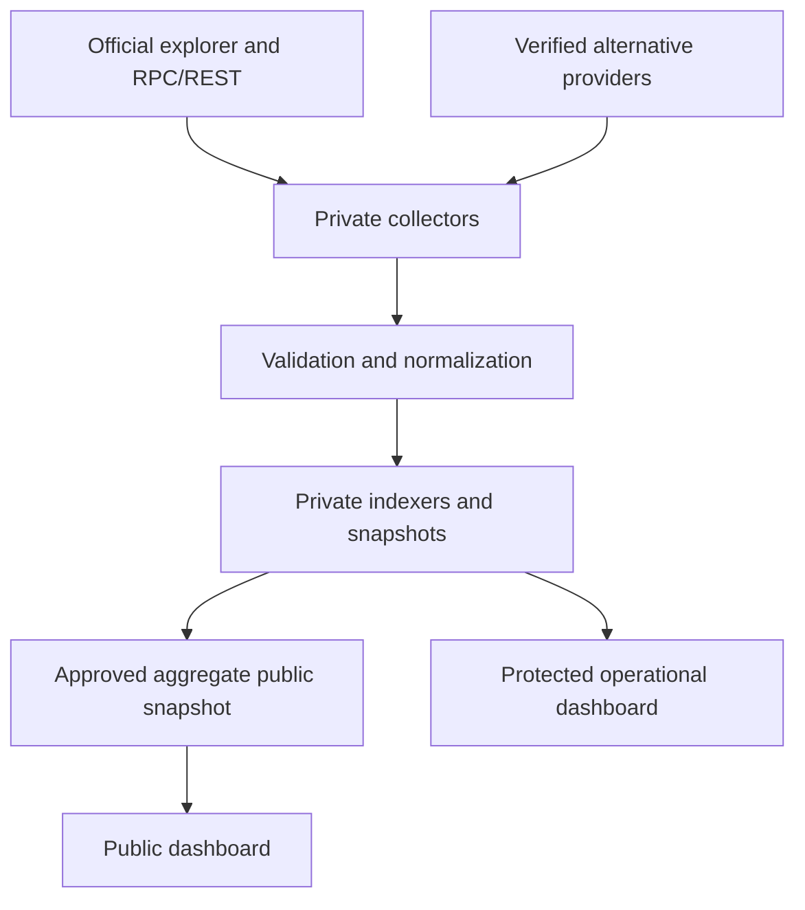

# Unification Network Intelligence

**Blockchain network intelligence for Unification: FUND, eFUND and xFUND.**

This repository documents the architecture, data-quality rules, monitoring modules and release safeguards of a blockchain intelligence dashboard. The project focuses on verifiable on-chain measurements rather than inferred or fabricated metrics.

> **Publication status:** Documentation-first. The live production implementation, private collector, internal APIs, runtime datasets and credentials are **not** included. The published documents describe the intended and previously observed system design; they do not certify that every module is currently complete or live.

## What the dashboard covers

| Area | Scope |
| --- | --- |
| Network health | Fresh chain tip, block time, source health, actual block/transaction counts |
| FUND | Native supply, bonded stake, validators, delegators and wallet movement indexing |
| Staking | Delegations, undelegations, redelegations, rewards, net stake changes and REStake evidence |
| Wallets | Native and Ethereum FUND holder distributions, concentration and labelled entities |
| eFUND | Verified utility/enterprise accounting, with missing attribution explicitly marked |
| xFUND | Per-network holders, supply, transfers, liquidity and oracle usage where independently verified |
| Indexing | Historical backfill, current live indexing, provenance, completeness and freshness |

## Architecture at a glance

**Boundary:** The public browser receives only intentionally published data. It does not fetch protected runtime JSON or private APIs. Values visible in a public page are, by definition, public information and may be copied by viewers.

## Documentation

- [Technical architecture](docs/ARCHITECTURE.md)
- [Data sources and measurement method](docs/DATA_SOURCES.md)
- [Staking intelligence](docs/STAKING_INTELLIGENCE.md)
- [Wallets and holder distribution](docs/WALLET_HOLDERS.md)
- [FUND, eFUND and xFUND distinctions](docs/TOKEN_NETWORKS.md)
- [Data quality and freshness](docs/DATA_QUALITY.md)
- [Release and deployment boundaries](docs/RELEASE_PROCESS.md)
- [Security policy](SECURITY.md)
- [Contributing](CONTRIBUTING.md)
- [Changelog](CHANGELOG.md)

## Principles

1. **No invented values.** Missing data is labelled `NO DATA`, `NOT INDEXED`, `STALE` or `SOURCE UNAVAILABLE` as appropriate.
2. **LIVE means fresh and verified for that module.** A healthy page does not make every metric live.
3. **Preserve economic meaning.** Avoid double-counting cross-chain FUND representations and distinguish gross staking activity from net stake changes.
4. **Do not infer trades from transfers.** An on-chain transfer is not automatically a BUY or SELL.
5. **Protect production.** Never upload operational JSON, secrets, authentication files, or production configuration.

## License

Check the repository's existing `LICENSE` file, if any, before publishing source code. Documentation publication does not automatically grant permission to redistribute private code or third-party assets. See [license notes](docs/LICENSING.md).

## Project independence

This is an independently maintained dashboard project. It is not presented as an official Unification explorer or as an endorsement by Unification. Product and token names belong to their respective owners.
