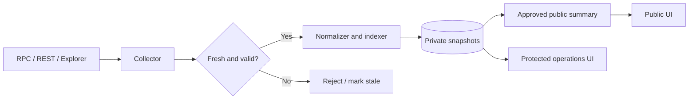

# Technical architecture

## Logical layers

1. **Source adapters** query the Unification explorer and official chain RPC/REST services. A documented alternative provider can be used for independent confirmation.
2. **Collectors** retrieve chain tip, blocks, transactions, fee data, balances, validators, delegations and supported token events.
3. **Indexers** normalize on-chain events into wallet movements, staking actions and historical coverage records.
4. **Integrity layer** checks timestamp freshness, provenance, completeness, units and consistency across sources.
5. **Private snapshots** aggregate bounded summaries. Operational JSON and collector logs are not public assets.
6. **Presentation layer** displays approved summaries via a server-side public snapshot, and operational diagnostics through a separately protected dashboard.

## Indexing model

**Live chain tip** is the most recently confirmed fresh block height. **History backfill cursor** is the next block to inspect while scanning older history; it is expected to decrease. Never compare the two as if they were the same counter. Historical progress must survive collector restarts, timeouts and partial runs.

A runtime feed may contain fresh measurements while a previously embedded summary contains older diagnostic metadata. Merge by field ownership, measurement time and validity, not by blindly replacing an entire object. Preserve verified diagnostics while selecting newer healthy measurement rows. Do not overwrite good state with an incomplete run.

## Staking architecture

Keep separate datasets for staking transactions, complete bonded-stake snapshots, reward events and validator/delegator relationships. A net change of zero between snapshots does **not** mean there were no delegation or reward transactions during the interval.

## Public/private boundary

Public HTML and JavaScript must not expose private endpoint URLs, credentials, collector internals or raw private JSON. Public server-side rendering can protect the source files, **not** the published metric values themselves. Use authentication and authorization for private paths; do not rely solely on an unguessable URL or `robots.txt`.

## Scope

This document is an architectural description, not a claim that all modules are fully implemented or live in the current deployment. Deployment status requires separate runtime verification.
